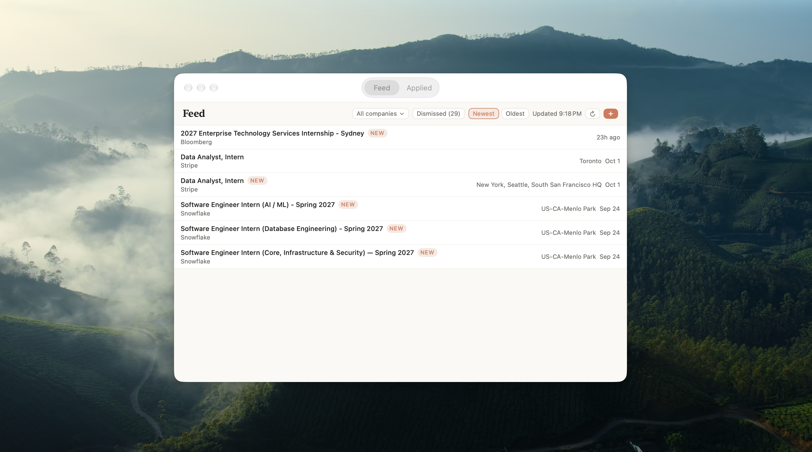

## barnacle — cling to the companies you care most about

tracks internship postings from the companies you pick, tells you when something new appears, and logs what you applied to.



### [Download for macOS](https://github.com/elizabeth-ling/barnacle/releases/download/v1.0/Barnacle-1.0.dmg)

v1.0 · Requires macOS 14 or later

### install

1. open `Barnacle-1.0.dmg`
2. drag Barnacle into Applications
3. open Barnacle from Applications

the first launch asks "are you sure you want to open it?" — that's macOS's standard prompt for anything downloaded from the internet. click Open.


### what it asks for

- permission to send notifications
- network access to the careers pages of the companies you add — and to ntfy.sh, only if you turn on iPhone notifications

no account, nothing else. your data stays on your Mac.

### build it yourself

requires Xcode and macOS 14 or later. Swift + SwiftUI.

```
open Barnacle.xcodeproj    # build & run with ⌘R
```

the feature specs live in [`context/`](context/).
