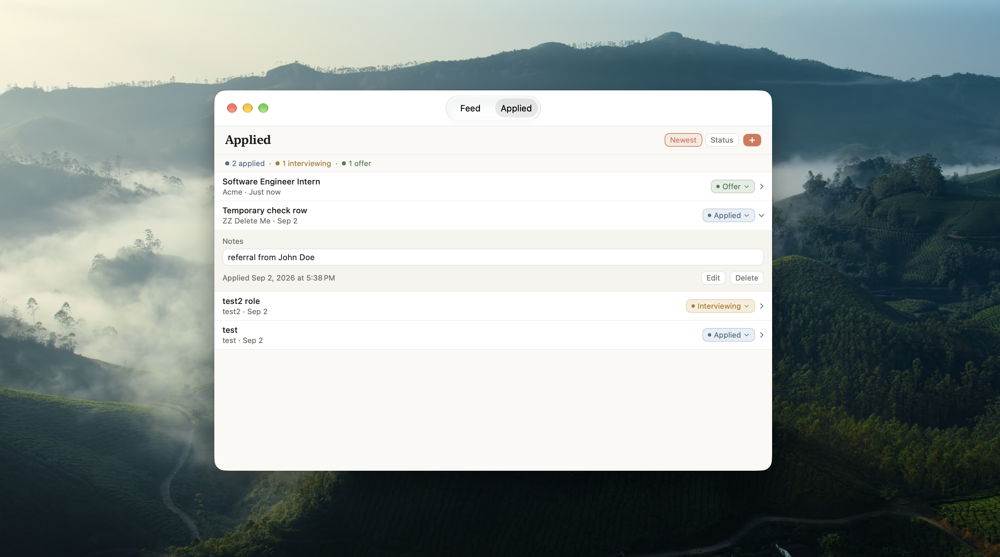

## barnacle — cling to the companies you care most about

tracks internship postings from the companies you pick, tells you when something new appears, and logs what you applied to.


### [Download for macOS](https://github.com/elizabeth-ling/barnacle/releases/download/v1.0/Barnacle-1.0.dmg)

v1.0 · Requires macOS 14 or later

### install

1. open `Barnacle-1.0.dmg`
2. drag Barnacle into Applications
3. open Barnacle from Applications

the first launch asks "are you sure you want to open it?" — that's macOS's standard prompt for anything downloaded from the internet. click Open.



### what it asks for

- permission to send notifications
- network access to the careers pages of the companies you add — and to ntfy.sh, only if you turn on iPhone notifications
- a daily check on GitHub for a new version. setup asks whether to install updates automatically; you can change it in Settings

no account, nothing else. your data stays on your Mac.

### build it yourself

requires Xcode and macOS 14 or later. Swift + SwiftUI.

```
open Barnacle.xcodeproj    # build & run with ⌘R
```

the feature specs live in [`context/`](context/).

### releasing

1. tag the commit and push the tag: `git tag v1.1 && git push origin v1.1`
2. the [Release workflow](.github/workflows/release.yml) builds, signs, and notarizes `Barnacle-1.1.dmg`, then attaches it and `appcast.xml` to a **draft** GitHub Release
3. try the DMG on a Mac that has never built the project, then publish the draft. installed copies only see an update once the release is published
4. point the download link above at the new version

every tag and release also shows "Source code (zip)" and "Source code (tar.gz)". GitHub adds those automatically; they aren't the app. if a release has only those two, the workflow failed, so check the Actions tab. once the cause is fixed, `gh run rerun <run-id>` retries the same tag.

notarization needs Apple's current Program License Agreement accepted at [developer.apple.com/account](https://developer.apple.com/account). when Apple updates it, every run fails with `403 ... A required agreement is missing or has expired` until the account holder accepts it again.
